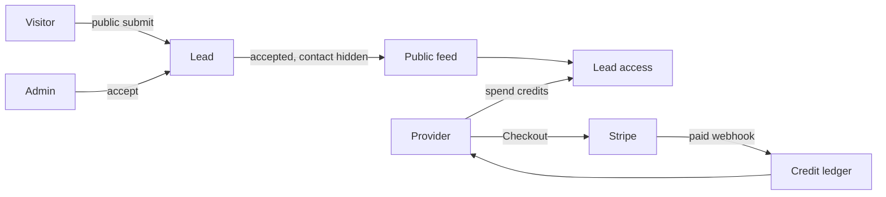

# 🏗️ Controfferta Backend

[](https://nodejs.org/)
[](https://www.typescriptlang.org/)
[](https://expressjs.com/)
[](https://mongoosejs.com/)
[](https://redis.io/)
[](https://www.elastic.co/)
[](https://vitest.dev/)
[](https://www.docker.com/)

A production-grade REST API and real-time server for **[Controfferta.it](https://controfferta.it/)**, the Italian marketplace that matches private clients with verified companies in renovations, solar, plants, windows, and roofing.

A visitor submits a project request. An admin accepts it onto the public lead feed, without the visitor's contact details. A provider company spends credits to unlock that contact. Providers buy credits with Stripe. The domain model is in [`docs/erd.md`](docs/erd.md).

---

## 📑 Table of Contents

- [Core Business Capabilities](#-core-business-capabilities)
- [How a lead is sold](#how-a-lead-is-sold)
- [Technology Stack](#-technology-stack)
- [System Architecture](#-system-architecture)
- [Directory Layout](#-directory-layout)
- [Prerequisites](#-prerequisites)
- [Getting Started](#-getting-started)
- [Environment Configuration](#-environment-configuration)
- [Running the Application](#-running-the-application)
- [API Documentation (OpenAPI / Swagger)](#-api-documentation-openapi--swagger)
- [Scaffolding New Modules](#-scaffolding-new-modules)
- [Testing & Quality Assurance](#-testing--quality-assurance)
- [Real-Time Events](#-real-time-events)
- [Background Workers & Cleanup Jobs](#-background-workers--cleanup-jobs)
- [Commit & Release Workflow](#-commit--release-workflow)

---

## 🚀 Core Business Capabilities

### How a lead is sold



1. Anyone can `POST /api/v1/leads/create`. No account is created.
2. An admin moves the lead from `pending` to `accepted` or `rejected`, and later from `accepted` to `closed`.
3. `GET /api/v1/leads` lists accepted leads. Contact details stay off this feed.
4. A provider unlocks a lead with `POST /api/v1/lead-accesses/unlock`. The charge is the category's current `creditCost`. The access row keeps the amount that was actually taken.
5. Credits arrive as a welcome grant, a paid package purchase, or an admin adjustment. Every change is a ledger row in the same database transaction as the balance update.

### 1. Multi-Role Authentication & Access Control (RBAC)

- Roles are **client**, **provider**, **admin**, and **super admin**.
- Public signup accepts `client` and `provider`. A super admin creates admin accounts. The process seeds one super admin from `SUPER_ADMIN_EMAIL` and `SUPER_ADMIN_PASSWORD` when none exists.
- Access and refresh JWTs. Passwords are hashed with bcrypt. Email verification and password reset go out through the mail queue.

### 2. Lead Marketplace

- Anyone can submit a project request. No account is created.
- An admin moves a lead from `pending` to `accepted` or `rejected`, and later from `accepted` to `closed`.
- The public feed lists accepted leads and can be searched by the project address. Contact details stay off the feed.
- Staff can read any lead, including contact. A provider can read an accepted lead, still without contact, until they unlock it.

### 3. Lead Unlock

- A provider spends credits to unlock one lead. The charge is the category's current `creditCost`.
- The access row stores the credits actually taken, so a later price change does not rewrite it.
- After unlock, the provider moves the job through `unlocked`, `contacted`, `in_progress`, and `completed`.
- Closing or rejecting a lead leaves existing unlock rows in place.

### 4. Credits, Packages, and Stripe

- Package prices, purchase totals, and transaction amounts are stored in **euros**. Stripe is charged in cents: the Price is created with `price * 100`, and the webhook divides Stripe amounts by 100 before saving them.
- `Provider.creditBalance` and ledger amounts are whole credits. A positive row adds credits. A negative row spends them. The balance cannot go below zero.
- A new provider receives `Setting.welcomeCreditAmount` credits. When that setting has not been saved, the grant is **15**. A stored `0` turns the grant off.
- Credits are posted only when the action is final: welcome on registration, purchase when Stripe reports the checkout paid, unlock when a lead is opened, and adjustment when an admin changes a balance. Starting checkout does not grant credits. A failed, expired, or repeated paid event does not grant them again.
- Paid fulfillment runs on `checkout.session.completed` and `checkout.session.async_payment_succeeded` when `payment_status` is `paid`. A `stripeEvent` row stops the same Stripe event from being applied twice.

### 5. Site Content and Support

- Public FAQ, blog posts, platform reviews, terms of service, and privacy policy.
- One platform settings document: welcome credits, contact details, a map point, and social links.
- Anyone can send a support message. Admins set status and priority.

### 6. Real-Time Chat and Notifications

- Socket.IO on the same HTTP server, authenticated with the JWT.
- Chat rooms, live messages, and in-app notifications pushed to `user:${userId}`.

### 7. Media Upload and Cleanup

- Authenticated uploads go to AWS S3.
- A new upload is tracked in the Redis sorted set `unlinked_media_uploads`.
- A BullMQ job runs every 6 hours and deletes files that are still unlinked after 6 hours.

---

## 🛠 Technology Stack

| Category | Technologies |
| :--- | :--- |
| **Runtime & Language** | [Node.js](https://nodejs.org/) (v20+; the Docker image is v22), [TypeScript](https://www.typescriptlang.org/) (v5.5+) in CommonJS mode |
| **Web Framework** | [Express](https://expressjs.com/) 4.x with CORS and express-rate-limit |
| **Primary Database** | [MongoDB](https://www.mongodb.com/) via [Mongoose](https://mongoosejs.com/) 8.x |
| **Caching & In-Memory Store** | [Redis](https://redis.io/) via [ioredis](https://github.com/redis/ioredis) 6.x |
| **Job Queue & Workers** | [BullMQ](https://bullmq.io/) 6.x for email, notifications, and media cleanup |
| **Search Engine** | [Elasticsearch](https://www.elastic.co/) 8.x client (`@elastic/elasticsearch`) |
| **Validation** | [Zod](https://zod.dev/) 3.23+ with strict request schemas |
| **API Documentation** | [Swagger UI](https://swagger.io/tools/swagger-ui/) & OpenAPI 3.0 via `@asteasolutions/zod-to-openapi` |
| **Third-Party Services** | [Stripe](https://stripe.com/) (Checkout & Webhooks), [AWS S3](https://aws.amazon.com/s3/) (`@aws-sdk/client-s3`), [Nodemailer](https://nodemailer.com/) |
| **Real-Time** | [Socket.IO](https://socket.io/) 4.x |
| **Testing** | [Vitest](https://vitest.dev/) 3.x, [Supertest](https://github.com/ladjs/supertest) 7.x, [`mongodb-memory-server`](https://github.com/nodkz/mongodb-memory-server) 11.x, `@vitest/coverage-v8` |
| **DevOps & CI/CD** | [Docker](https://www.docker.com/), GitHub Actions, Semantic Release, Commitizen |

---

## 🏛 System Architecture

The project keeps the Express app separate from the process that opens ports and connections:

```
                  ┌──────────────────────┐
                  │    HTTP Requests     │
                  └──────────┬───────────┘
                             │
                             ▼
                  ┌──────────────────────┐
                  │      src/app.ts      │ ◄── Pure Express (routes, middleware,
                  └──────────┬───────────┘     errors; no listeners or DB connects)
                             │
           ┌─────────────────┴─────────────────┐
           ▼                                   ▼
┌──────────────────────┐            ┌──────────────────────┐
│ src/server.ts        │            │   tests/integration  │
│ src/dev-server.ts    │            │     (Supertest)      │
├──────────────────────┤            ├──────────────────────┤
│ • MongoDB Connect    │            │ • In-Memory MongoDB  │
│ • Super admin seed   │            │ • Zero Port Binding  │
│ • Elasticsearch Ping │            │ • Stripe, S3, Redis, │
│ • BullMQ Workers     │            │   Elasticsearch, and │
│ • Socket.IO Listener │            │   SMTP are mocked    │
│ • app.listen()       │            └──────────────────────┘
└──────────────────────┘
```

A protected request runs `auth(...)`, then `validateRequest(schema)`, then a thin controller. The service throws `ApiError` for expected failures.

Success responses look like this:

```json
{
  "success": true,
  "message": "Lead unlocked successfully",
  "statusCode": 201,
  "data": {}
}
```

List routes add `pagination`. Validation failures return `400` with `success: false` and `errorMessages`. A missing token is `401`. The wrong role is `403`.

`POST /webhooks/stripe` is registered with `express.raw` before the JSON parser, so Stripe can verify the signature. The handler answers `200` after it accepts the event.

---

## 📂 Directory Layout

Domain features live under `src/app/modules/<moduleName>`:

```text
src/
├── app/
│   ├── loaders/                  # BullMQ workers and Elasticsearch index setup
│   ├── middlewares/              # auth, socketAuth, validation, uploads, rate limit, errors
│   ├── modules/
│   │   ├── admin/                # Admin accounts, created by a super admin
│   │   ├── auth/                 # Login, refresh, email verification, password reset
│   │   ├── blog/                 # Category articles, published after admin review
│   │   ├── category/             # Service categories and the credit cost of an unlock
│   │   ├── chat/                 # Chat threads
│   │   ├── creditLedger/         # Every credit balance change
│   │   ├── creditPackage/        # Credit packages and their Stripe Prices
│   │   ├── creditPurchase/       # Checkout sessions started by a provider
│   │   ├── disclaimer/           # Terms of service and privacy policy
│   │   ├── faq/                  # Public frequently asked questions
│   │   ├── lead/                 # Project requests and the public feed
│   │   ├── leadAccess/           # A provider's unlock of one lead
│   │   ├── mediaUpload/          # S3 uploads and unlinked-file tracking
│   │   ├── message/              # Chat messages
│   │   ├── notification/         # In-app notifications and the notification worker
│   │   ├── platformReview/       # Reviews of the platform
│   │   ├── setting/              # The single site settings document
│   │   ├── stripeEvent/          # Webhook idempotency records
│   │   ├── support/              # Public contact messages
│   │   ├── transaction/          # Payment records, amounts in euros
│   │   ├── user/                 # Accounts, roles, and provider signup
│   │   └── wallet/               # Template payout routes, not used for credits
│   └── webhooks/
│       └── stripe/               # Raw body, signature check, and credit fulfillment
├── api-docs/                     # OpenAPI registry
├── config/                       # Env, Redis, Stripe, S3, Elasticsearch
├── DB/                           # Super admin seed
├── helpers/                      # JWT, mail, sockets
├── routes/                       # Mounts every router under /api/v1
├── scripts/                      # create-module.ts
├── shared/                       # catchAsync, sendResponse, logger
├── app.ts                        # Express app, no port and no database connection
├── dev-server.ts                 # Local entry, listens on PORT_DEV
└── server.ts                     # Production entry, listens on PORT
```

---

## 📋 Prerequisites

- **Node.js** v20 or newer. The Docker image uses Node 22.
- **npm**
- **MongoDB**
- **Redis** v6 or newer, for BullMQ and rate limits
- **Elasticsearch** 8.x
- **Docker & Docker Compose**, optional, for the containerized server

Stripe, S3, and SMTP can stay on test credentials until those paths are exercised.

---

## ⚡ Getting Started

### 1. Clone the Repository

```bash
git clone https://github.com/Rahad-Ullah/controfferta-backend.git
cd controfferta-backend
```

### 2. Install Dependencies

```bash
npm install
```

---

## ⚙️ Environment Configuration

Copy `.env.example` to `.env` and replace every placeholder. Do not commit `.env`.

```env
# -------------------- Server Configuration --------------------
SERVER_NAME=Controfferta
NODE_ENV=development
PORT=5000                         # Production port (npm start)
PORT_DEV=5001                     # Development port (npm run dev)
IP_ADDRESS=127.0.0.1
FRONTEND_URL=http://localhost:3000
BACKEND_URL=http://localhost:5001
MEDIA_SERVER_URL=http://localhost:5001
LOGO_URL=

# -------------------- Database & Cache --------------------
DATABASE_URL=mongodb://127.0.0.1:27017/controfferta
REDIS_URL=redis://127.0.0.1:6379

# -------------------- Security & Tokens --------------------
BCRYPT_SALT_ROUNDS=12
CRYPTO_SECRET=your_32_character_crypto_secret_key
JWT_SECRET=your_super_secret_jwt_access_key
JWT_EXPIRE_IN=1d
JWT_REFRESH_SECRET=your_super_secret_jwt_refresh_key
JWT_REFRESH_EXPIRE_IN=7d

# -------------------- Email (SMTP) --------------------
EMAIL_FROM=info@controfferta.it
EMAIL_REPLY_TO=info@controfferta.it
EMAIL_USER=your_smtp_username
EMAIL_PASS=your_smtp_password
EMAIL_HOST=smtp.gmail.com
EMAIL_PORT=587

# -------------------- Super Admin Credentials --------------------
SUPER_ADMIN_EMAIL=super.admin@controfferta.it
SUPER_ADMIN_PASSWORD=your_super_admin_password

# -------------------- Stripe Payments --------------------
STRIPE_API_VERSION=2024-06-20
STRIPE_PUBLIC_KEY=pk_test_...
STRIPE_SECRET_KEY=sk_test_...
STRIPE_WEBHOOK_SECRET=whsec_...

# -------------------- AWS S3 Storage --------------------
AWS_REGION=eu-south-1
AWS_ACCESS_KEY_ID=your_aws_access_key
AWS_SECRET_ACCESS_KEY=your_aws_secret_key
S3_BUCKET_NAME=your_bucket_name

# -------------------- Elasticsearch --------------------
ELASTICSEARCH_NODE=http://127.0.0.1:9200
ELASTICSEARCH_USERNAME=elastic
ELASTICSEARCH_PASSWORD=changeme
ELASTICSEARCH_API_KEY=
```

Forward Stripe events to the raw webhook while developing payments:

```bash
stripe listen --forward-to localhost:5001/webhooks/stripe
```

Put the signing secret it prints into `STRIPE_WEBHOOK_SECRET`.

---

## 🏃 Running the Application

### Development Mode

Runs `src/dev-server.ts` with hot reload via `ts-node-dev`. It listens on `PORT_DEV`.

```bash
npm run dev
```

### Production Build & Run

Compiles TypeScript into `dist/` and starts `src/server.ts` on `PORT`.

```bash
npm run build
npm start
```

On boot the process connects to MongoDB, seeds the super admin when that role is missing, pings Elasticsearch, opens Socket.IO on the same HTTP server, and starts the BullMQ workers.

### Running with Docker

```bash
# Development server
docker compose --profile dev up --build

# Production server
docker compose --profile prod up -d --build
```

---

## 📖 API Documentation (OpenAPI / Swagger)

The OpenAPI 3.0 document is generated from the Zod schemas with `@asteasolutions/zod-to-openapi`.

- **Swagger UI:** [http://localhost:5001/api-docs](http://localhost:5001/api-docs)
- **OpenAPI JSON:** [http://localhost:5001/api-docs/v1.json](http://localhost:5001/api-docs/v1.json)

Send `Authorization: Bearer <token>` on protected routes.

### Primary Route Endpoints

| Resource | Route Prefix | Description |
| :--- | :--- | :--- |
| **Auth** | `/api/v1/auth` | Login, refresh, email verification, and password reset |
| **Users** | `/api/v1/users` | Register `client` or `provider`, profile, and admin user management |
| **Admins** | `/api/v1/admins` | Super admin creates and updates admins |
| **Categories** | `/api/v1/categories` | Service categories. `creditCost` is what an unlock charges |
| **Leads** | `/api/v1/leads` | Public submit and the public feed of accepted leads |
| **Lead access** | `/api/v1/lead-accesses` | A provider unlocks a lead and updates the job status |
| **Credit packages** | `/api/v1/credit-packages` | Public catalog. Admins create, update, and retire packages |
| **Credit purchases** | `/api/v1/credit-purchases` | A provider starts Stripe Checkout for one package |
| **Credit ledger** | `/api/v1/credit-ledgers` | Balance history. Admins can post an adjustment |
| **Transactions** | `/api/v1/transactions` | Payment records. Amounts are euros |
| **Notifications** | `/api/v1/notifications` | The signed-in user's notifications |
| **Support** | `/api/v1/supports` | Public contact messages. Admins handle the inbox |
| **Platform reviews** | `/api/v1/platform-reviews` | User reviews. The public list shows `published` only |
| **Blog** | `/api/v1/blogs` | Admin-written articles. The public list shows `published` only |
| **FAQ** | `/api/v1/faqs` | Public read. Admin write |
| **Disclaimers** | `/api/v1/disclaimers` | `terms_of_service` and `privacy_policy`, one document each |
| **Settings** | `/api/v1/settings` | The one site document: welcome credits, contact, social links |
| **Media** | `/api/v1/media-uploads` | Authenticated upload to S3 |
| **Chats & Messages** | `/api/v1/chats`, `/api/v1/messages` | Chat threads and messages |
| **Wallets** | `/api/v1/wallets` | Template payout routes. Credit purchases do not use them |
| **Webhooks** | `/webhooks/stripe` | Raw-body Stripe webhook. Idempotent by event id |

---

## 🧩 Scaffolding New Modules

```bash
npm run cm <name>
```

The script writes `src/app/modules/<camelName>/` with the interface, model, validation, constants, service, controller, and route. Register the router in `src/routes/index.ts`, add a `register<Name>Docs()` call in `src/api-docs/openapi.ts`, and check the collection against [`docs/erd.md`](docs/erd.md).

---

## 🧪 Testing & Quality Assurance

Tests are integration-first. The plan is in [`docs/testing-strategy.md`](docs/testing-strategy.md).

- **In-memory MongoDB:** HTTP tests call the Express app through Supertest. Nothing binds a port.
- **Isolated state:** collections are cleared between tests in `tests/setup.ts`.
- **Mocks:** BullMQ, Redis, Elasticsearch, Nodemailer, AWS S3, and Stripe are stubbed under `tests/mocks/`.

| Task | Command | Description |
| :--- | :--- | :--- |
| **Run All Tests** | `npm test` | Vitest, once |
| **One File** | `npx vitest run tests/integration/lead.test.ts` | A single area |
| **Typecheck** | `npx tsc --noEmit` | TypeScript with no emit |
| **Watch Mode** | `npm run test:watch` | Vitest in watch mode |
| **Coverage Report** | `npm run test:coverage` | Writes the `coverage/` report |
| **Check Linting** | `npm run lint:check` | ESLint on `src` |
| **Fix Linting** | `npm run lint:fix` | ESLint autofix |
| **Prettier Format** | `npm run prettier:fix` | Formats the repo |

---

## 🔒 Real-Time Events

Socket.IO authenticates the handshake with the JWT middleware.

- `connection`: joins `user:${userId}` and marks the user online.
- `room:join` / `room:leave`: enters or leaves `chat:${chatId}`. The user must be a participant.
- `getMessage` and `getChatList`: emitted when a message is saved.
- `getNotification`: emitted to `user:${userId}` when a notification is created.
- `disconnect`: marks the user offline when no other socket for that user remains.

---

## 🔄 Background Workers & Cleanup Jobs

Workers start from `src/app/loaders/bullmq.loader.ts`:

- **Email:** Nodemailer sends run on the email queue, so request handlers do not wait on SMTP.
- **Notifications:** a worker delivers notification jobs.
- **Unlinked media:** uploads are scored in the Redis sorted set `unlinked_media_uploads`. Linking a file removes it from the set. A repeatable job (`0 */6 * * *`) deletes S3 objects that are still unlinked after 6 hours.

---

## 📝 Commit & Release Workflow

Commits follow **Conventional Commits** through **Commitizen**. Releases are cut by **Semantic Release**.

### Commitizen CLI

```bash
git add .
npm run commit
```

The prompts use:

- `feat(scope)`: a new feature or endpoint.
- `fix(scope)`: a bug fix.
- `test(scope)`: tests.
- `refactor(scope)`: a behavior-preserving change.
- `perf(scope)`: a performance change.
- `docs(scope)`: documentation.
- `chore(scope)`: tooling, dependencies, or config.

### CI/CD

- **`test.yml`**: ESLint and Vitest coverage on every pull request and on pushes to `main` and `master`. The job uses Node 20.
- **`docker-publish.yml`**: builds the image and pushes it to GitHub Container Registry.
- **`release.yml`**: Semantic Release versions the repo and publishes the GitHub Release from Conventional Commits on `main`.

---

## 📄 License

This project is licensed under the **ISC License**. Developed and maintained by [Rahad Ullah](https://github.com/Rahad-Ullah).
