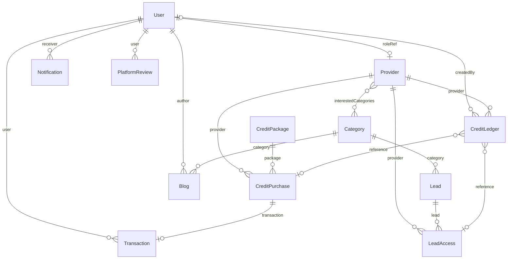

# Entity relationship model

**Project:** `controfferta-backend`  
**Status:** Working spec for implementation.  
**Updated:** 7 Nov 2026

This file is the domain model. New modules follow it. A client submits a lead without an account. A provider spends credits to unlock that lead's contact. Admins approve leads, price categories, and sell credit packages.

## Roles

| Role | Meaning |
| :--- | :--- |
| `client` | Reserved. No profile collection yet. Lead submit does not create a user. |
| `provider` | Company account. `User.roleRef` points at `Provider`. |
| `admin` | Staff account. A `User` row. No separate profile in this model. |
| `super_admin` | Staff account that creates admins. A `User` row. |

## Money and credits

- `CreditPackage.price`, `CreditPurchase.pricing`, and `Transaction.amount` are euros. The default currency is `EUR`. Stripe is charged in cents: the package price is multiplied by 100 when the Price is created, and the webhook divides Stripe amounts by 100 before saving them.
- `Provider.creditBalance` and `CreditLedger.amount` are integer credits. A positive ledger amount adds credits. A negative amount spends them.
- The feed shows the current `Category.creditCost`. `LeadAccess.creditCost` stores the credits actually taken at unlock.
- `budgetRange` is the client's estimate in euros, stored as entered.

## Diagram

`Support`, `Disclaimer`, and `PlatformSetting` stand alone.

## 1. User

Account document. Matches the current `User` model.

| Field | Type | Notes |
| :--- | :--- | :--- |
| `_id` | ObjectId | |
| `uid` | string | Unique. Prefix `USR`. |
| `firstName` | string | Required |
| `lastName` | string | Required |
| `email` | string | Required, unique, lowercase |
| `password` | string | Hashed. Minimum 8 characters. |
| `role` | enum | `client`, `provider`, `admin`, `super_admin` |
| `roleRef` | ObjectId | Set for `provider`. Points at `Provider`. |
| `image` | string | |
| `phone.countryCode` | string | |
| `phone.number` | string | |
| `address.line1` | string | |
| `address.line2` | string | |
| `address.city` | string | |
| `address.state` | string | |
| `address.country` | string | |
| `address.postalCode` | string | |
| `location.type` | string | `Point` |
| `location.coordinates` | number[2] | `[longitude, latitude]` |
| `status` | enum | `active`, `suspended`, `banned` |
| `isOnline` | boolean | |
| `lastSeenAt` | date | |
| `isEmailVerified` | boolean | |
| `isNotificationEnabled` | boolean | |
| `isDeleted` | boolean | |
| `authentication.isResetPassword` | boolean | Hidden |
| `authentication.oneTimeCode` | number | Hidden |
| `authentication.expireAt` | date | Hidden |
| `createdAt` | date | |
| `updatedAt` | date | |

## 2. Provider

| Field | Type | Notes |
| :--- | :--- | :--- |
| `_id` | ObjectId | |
| `user` | ObjectId | FK to `User`. One provider per user. |
| `businessName` | string | |
| `businessType` | enum | `company`, `agency`, `individual` |
| `bio` | string | |
| `interestedCategories` | ObjectId[] | FK to `Category` |
| `creditBalance` | integer | Cached credit total. The ledger is the source of truth. |

## 3. Category

Service taxonomy and the live credit price.

| Field | Type | Notes |
| :--- | :--- | :--- |
| `_id` | ObjectId | |
| `name` | string | |
| `description` | string | |
| `iconUrl` | string | |
| `creditCost` | integer | Credits charged to unlock a lead in this category |
| `isDeleted` | boolean | |
| `createdAt` | date | |
| `updatedAt` | date | |

Blog posts use this same collection as their category.

## 4. Lead

A project request. The submitter has no user account. Contact is stored on the lead.

| Field | Type | Notes |
| :--- | :--- | :--- |
| `_id` | ObjectId | |
| `uid` | string | Unique public id |
| `category` | ObjectId | FK to `Category` |
| `title` | string | |
| `description` | string | Shown in the feed before unlock |
| `address` | string | Project site. This is the provider search string. |
| `location.type` | string | `Point` |
| `location.coordinates` | number[2] | `[longitude, latitude]`. Map pin. |
| `budgetRange.minimum` | number | Euros |
| `budgetRange.maximum` | number | Euros |
| `timeline` | string | |
| `client.name` | string | Hidden until unlock |
| `client.email` | string | Hidden until unlock |
| `client.phone.countryCode` | string | Hidden until unlock |
| `client.phone.number` | string | Hidden until unlock |
| `client.address` | string | Contact address. Hidden until unlock. |
| `status` | enum | `pending`, `accepted`, `rejected`, `closed` |
| `isDeleted` | boolean | |
| `createdAt` | date | |
| `updatedAt` | date | |

`accepted` leads are the feed. `pending`, `rejected`, and `closed` leads are hidden from providers. Closing or rejecting a lead keeps existing `LeadAccess` rows, so a provider who already paid still has the contact.

## 5. LeadAccess

Created when a provider unlocks a lead. One row per provider and lead.

| Field | Type | Notes |
| :--- | :--- | :--- |
| `_id` | ObjectId | |
| `lead` | ObjectId | FK to `Lead` |
| `provider` | ObjectId | FK to `Provider` |
| `creditCost` | integer | Credits taken for this unlock |
| `status` | enum | `unlocked`, `contacted`, `in_progress`, `completed` |
| `isDeleted` | boolean | |
| `unlockedAt` | date | |
| `createdAt` | date | |
| `updatedAt` | date | |

The first status is `unlocked`. The provider then moves it to `contacted`, `in_progress`, and `completed`.

## 6. CreditLedger

Append-only. Every change to `Provider.creditBalance` writes one row in the same Mongo transaction as the balance update. Rows are never edited and never soft-deleted.

| Field | Type | Notes |
| :--- | :--- | :--- |
| `_id` | ObjectId | |
| `uid` | string | Unique |
| `provider` | ObjectId | FK to `Provider` |
| `type` | enum | `purchase`, `welcome`, `unlock`, `refund`, `adjustment` |
| `amount` | integer | Signed credits |
| `balanceAfter` | integer | `creditBalance` after this row |
| `reference.type` | enum | `credit_purchase`, `lead_access`. Empty for `welcome` and `adjustment`. |
| `reference.id` | ObjectId | FK to the purchase or the lead access. Empty for `welcome` and `adjustment`. |
| `note` | string | Required for `adjustment`. Empty otherwise. |
| `createdBy` | ObjectId | FK to `User`. Set for `adjustment`. Empty otherwise. |
| `createdAt` | date | |

| type | amount | reference |
| :--- | :--- | :--- |
| `purchase` | `+creditsAmount` | `credit_purchase` |
| `welcome` | `+welcomeCreditAmount` | empty |
| `unlock` | `-creditCost` | `lead_access` |
| `refund` | opposite of the row it reverses | the purchase or the lead access being reversed |
| `adjustment` | either sign | empty, with a `note` |

An unlock updates the provider only while `creditBalance` is still at least `creditCost`.

Where `reference.id` is set, the pair `(reference.type, reference.id, type)` is unique. A webhook retry or a second unlock cannot post the same row twice.

## 7. CreditPackage

| Field | Type | Notes |
| :--- | :--- | :--- |
| `_id` | ObjectId | |
| `name` | string | |
| `description` | string | |
| `creditsAmount` | integer | Credits granted on a paid purchase |
| `price` | integer | Euros. Stripe receives this value times 100. |
| `tag` | enum | Optional. `popular`, `recommended` |
| `stripeProductId` | string | |
| `stripePriceId` | string | |
| `status` | enum | `active`, `inactive` |
| `purchaseCount` | integer | Incremented when a purchase is paid |
| `isDeleted` | boolean | |
| `createdAt` | date | |
| `updatedAt` | date | |

## 8. CreditPurchase

| Field | Type | Notes |
| :--- | :--- | :--- |
| `_id` | ObjectId | |
| `uid` | string | Unique |
| `provider` | ObjectId | FK to `Provider`. The company that buys the credits. |
| `package` | ObjectId | FK to `CreditPackage` |
| `creditsAmount` | integer | Snapshot from the package |
| `pricing.subtotal` | integer | Euros |
| `pricing.discount` | integer | Euros |
| `pricing.total` | integer | Euros |
| `pricing.currency` | string | `EUR` |
| `paymentStatus` | enum | `unpaid`, `paid`, `refunded` |
| `transaction` | ObjectId | FK to `Transaction` |
| `isDeleted` | boolean | |
| `createdAt` | date | |
| `updatedAt` | date | |

`Transaction.status` is the source of truth. `paymentStatus` is written in the same update.

## 9. Transaction

| Field | Type | Notes |
| :--- | :--- | :--- |
| `_id` | ObjectId | |
| `uid` | string | Unique |
| `user` | ObjectId | FK to `User` |
| `reference.type` | enum | `credit_purchase` |
| `reference.id` | ObjectId | FK to `CreditPurchase` |
| `type` | enum | `payment`, `refund` |
| `amount` | number | Euros |
| `gatewayFee` | number | Euros |
| `currency` | string | `EUR` |
| `paymentMethod` | string | `card`, `klarna`, `ideal`, and other Stripe methods |
| `gateway` | enum | `stripe`, `paypal`, `manual` |
| `gatewayReferenceId` | string | |
| `status` | enum | `pending`, `completed`, `failed`, `cancelled` |
| `isPaid` | boolean | |
| `paidAt` | date | |
| `createdAt` | date | |
| `updatedAt` | date | |

## 10. Notification

| Field | Type | Notes |
| :--- | :--- | :--- |
| `_id` | ObjectId | |
| `type` | string | Closed set when the module is built: new lead, low balance, credit purchase |
| `title` | string | |
| `message` | string | |
| `receiver` | ObjectId | FK to `User` |
| `referenceId` | string | |
| `isRead` | boolean | |
| `createdAt` | date | |
| `updatedAt` | date | |

## 11. PlatformReview

| Field | Type | Notes |
| :--- | :--- | :--- |
| `_id` | ObjectId | |
| `user` | ObjectId | FK to `User` |
| `rating` | number | |
| `message` | string | |
| `status` | enum | `pending`, `published`, `hidden` |
| `isDeleted` | boolean | |
| `createdAt` | date | |
| `updatedAt` | date | |

## 12. Blog

| Field | Type | Notes |
| :--- | :--- | :--- |
| `_id` | ObjectId | |
| `category` | ObjectId | FK to `Category` |
| `title` | string | |
| `description` | string | |
| `bodyContent` | string | |
| `imageUrl` | string | |
| `author` | ObjectId | FK to `User` |
| `status` | enum | `pending`, `published`, `hidden` |
| `isDeleted` | boolean | |
| `createdAt` | date | |
| `updatedAt` | date | |

## 13. Support

Public contact message. No user account required.

| Field | Type | Notes |
| :--- | :--- | :--- |
| `_id` | ObjectId | |
| `firstName` | string | |
| `lastName` | string | |
| `email` | string | |
| `subject` | string | |
| `message` | string | |
| `status` | enum | `open`, `in_progress`, `resolved`, `closed` |
| `priority` | enum | `low`, `medium`, `high` |
| `isDeleted` | boolean | |
| `createdAt` | date | |
| `updatedAt` | date | |

## 14. Disclaimer

| Field | Type | Notes |
| :--- | :--- | :--- |
| `_id` | ObjectId | |
| `type` | enum | `terms_of_service`, `privacy_policy` |
| `content` | string | |

## 15. PlatformSetting

One document for the site.

| Field | Type | Notes |
| :--- | :--- | :--- |
| `_id` | ObjectId | |
| `welcomeCreditAmount` | integer | Credits granted once when a provider registers. Defaults to 15 when the setting is missing. |
| `contactInfo.email` | string | |
| `contactInfo.phone` | string | |
| `contactInfo.whatsApp` | string | |
| `contactInfo.address.line1` | string | |
| `contactInfo.address.line2` | string | |
| `contactInfo.address.city` | string | |
| `contactInfo.address.state` | string | |
| `contactInfo.address.postalCode` | string | |
| `contactInfo.address.country` | string | |
| `contactInfo.location.type` | string | `Point` |
| `contactInfo.location.coordinates` | number[2] | `[longitude, latitude]` |
| `socialLinks.facebook` | string | |
| `socialLinks.instagram` | string | |
| `socialLinks.twitter` | string | |
| `socialLinks.linkedin` | string | |
| `socialLinks.youtube` | string | |
| `socialLinks.tiktok` | string | |
| `socialLinks.reddit` | string | |
| `socialLinks.weChat` | string | |
| `socialLinks.discord` | string | |
| `socialLinks.telegram` | string | |

## Indexes

| Collection | Index |
| :--- | :--- |
| `User` | unique `email`, unique `uid`, `2dsphere` on `location` |
| `Provider` | unique `user` |
| `Lead` | unique `uid`, text index on `address` |
| `LeadAccess` | unique `(lead, provider)` |
| `CreditLedger` | unique `uid`, unique `(reference.type, reference.id, type)` where `reference.id` is set |
| `CreditPurchase` | unique `uid` |
| `Transaction` | unique `uid` |
| `Disclaimer` | unique `type` |

## Build order

1. Category
2. Provider, created with user registration
3. Lead submit and admin review
4. Credit ledger and welcome grant
5. Lead unlock
6. Credit package, credit purchase, and the Stripe payment
7. Blog, support, platform review, disclaimer, and platform setting changes
